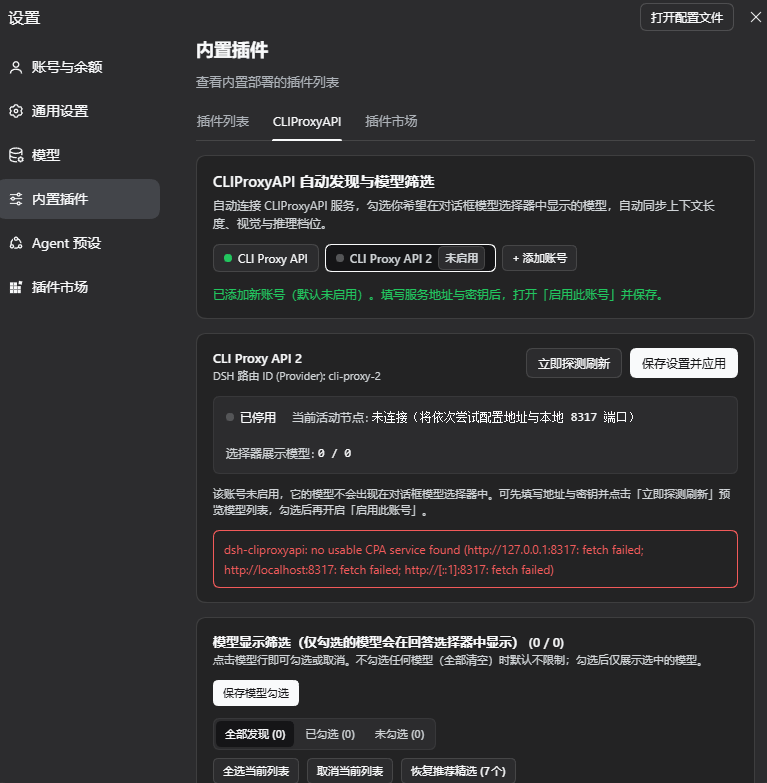
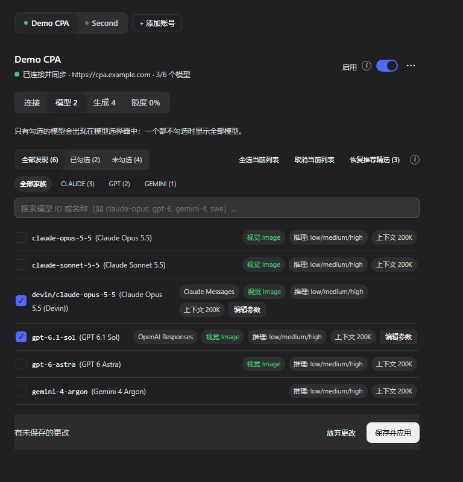
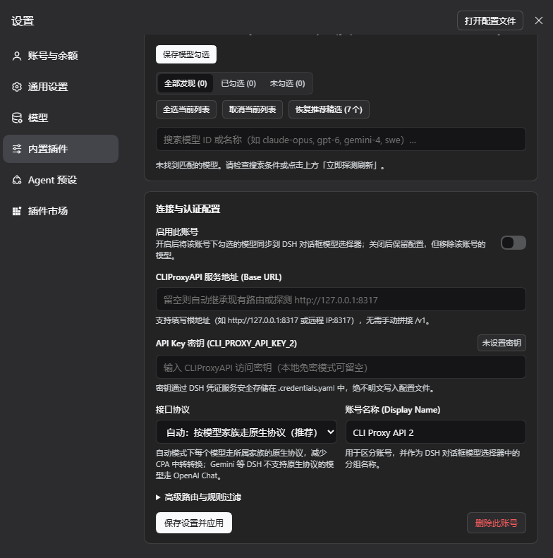

# dsh-cliproxyapi-pro (v1.4.0)

English | [中文](README.zh.md)

[](https://github.com/TinyBOOOOM/dsh-cliproxyapi-pro/actions/workflows/ci.yml)
[](LICENSE)

A [CLIProxyAPI](https://github.com/router-for-me/CLIProxyAPI) provider for **DeepSeek Harness (DSH `>=0.2.0-rc.1`)**. It discovers CPA servers, synchronizes their model catalogs and capabilities (context window, image input, reasoning levels) into the DSH model picker, and supports **multiple accounts** that can each be enabled or disabled, with a visual model filter and per-model parameter overrides.

- No runtime dependencies and no build step; only Node.js built-ins and DSH (Cordis) context services.
- API keys are stored only in the DSH credentials service, never in configuration files.

## Contents

- [Features](#features)
- [Screenshots](#screenshots)
- [Installation](#installation)
- [Usage](#usage)
  - [Settings panel](#settings-panel)
  - [Multiple accounts](#multiple-accounts)
  - [Agent tool `cliproxyapi`](#agent-tool-cliproxyapi)
  - [Slash commands](#slash-commands)
  - [HTTP API](#http-api)
- [Protocol routing](#protocol-routing)
- [Storage and configuration](#storage-and-configuration)
- [AI installation protocol](#ai-installation-protocol)
- [Development](#development)
- [License](#license)

## Features

1. **Auto-discovery.** Enter a remote or local URL (suffixes such as `/v1`, `/v1/chat/completions` and `/v1/messages` are stripped), or leave it empty to try the existing route URL, the `CLIPROXYAPI_BASE_URL` environment variable, and local `127.0.0.1:8317` in turn. The enriched catalog comes from `/v1/models?client_version=pi` (OpenAI `data[]` catalogs work too); `owned_by` from `/v1/models` identifies each model's family.
2. **Model filter.** Search, family chips, All / Checked / Unchecked tabs and bulk selection. **Only checked models appear in the conversation model picker.** An empty selection means no filter; include / exclude keyword rules apply on top. An account that has never saved a selection starts with the newest model of each family in its own server's catalog (at most 12); **Reset to Recommended** restores that set.
3. **Per-model overrides.** Context window, max output, image input, thinking levels (`off` … `max`) and request protocol, each resettable to the discovered value.
4. **Native protocol per model family** (default). See [Protocol routing](#protocol-routing).
5. **Multiple accounts.** Each account has its own URL, key, routes, protocol, selection and overrides, and can be enabled or disabled on its own. See [Multiple accounts](#multiple-accounts).
6. **Automatic refresh.** All accounts refresh on a shared interval (300 s by default); an unchanged catalog writes no settings.

## Screenshots

The panel lives in the **Settings → Built-in plugins → CLIProxyAPI** tab and follows the DSH display language; the screenshots show the Chinese UI.

**1. Account bar and account status.** The bar at the top lists every account: a green dot means connected, a grey dot plus the **Off** badge means disabled. Here a second account, *CLI Proxy API 2*, was just added with **+ Add Account**: it starts disabled, gets its own provider route `cli-proxy-2`, and — since no base URL is set yet — the probe reports that no local CPA was found.



**2. Model picker filter.** All 168 models discovered from the CPA server, with All / Checked / Unchecked tabs, family chips (GPT, CLAUDE, GEMINI, GROK, …), search and bulk actions. Checked models are the only ones synchronized into the DSH model picker; each shows the protocol it will use (here OpenAI Responses), image input, reasoning levels and context window, and **Edit Parameters** opens its per-model overrides.



**3. Connection & Authentication.** Per-account settings: the **Enable This Account** switch, base URL, API key stored under the account's own credential ref (`CLI_PROXY_API_KEY_2`), wire protocol, account name, the collapsible advanced section, **Save & Apply** and **Delete Account**.



## Installation

Ask the agent in a DSH conversation to install it with `plugin_manager`, using one of these targets:

| Source | `target` |
|---|---|
| GitHub, latest `main` | `git+https://github.com/TinyBOOOOM/dsh-cliproxyapi-pro.git#main` |
| GitHub, a release tag | `git+https://github.com/TinyBOOOOM/dsh-cliproxyapi-pro.git#v1.4.0` (see [Releases](https://github.com/TinyBOOOOM/dsh-cliproxyapi-pro/releases)) |
| GitHub Release `.tgz` | Download [`dsh-cliproxyapi-pro.tgz`](https://github.com/TinyBOOOOM/dsh-cliproxyapi-pro/releases/latest/download/dsh-cliproxyapi-pro.tgz) (always the latest release) and pass its absolute path |
| Local checkout (development, linked) | Absolute path of the cloned repository |
| npm (once published) | `dsh-cliproxyapi-pro` |

```json
{ "action": "install_bundle", "target": "<target from the table>", "enabled": true }
```

- Installing a directory links it (`source: link:<dir>`); code changes go live when the plugin reloads.
- Reinstalling over an older version is fine; replacing an installed package needs a DSH restart to load the new code.
- If the result's `application` is `restart-required`, restart DSH.

After installation, open:

- Sidebar → **Plugins** → **CLIProxyAPI**
- **Settings** → **Built-in plugins** → **CLIProxyAPI** tab

## Usage

### Settings panel

The **account bar** at the top switches between accounts (the dot shows each account's state; disabled accounts carry an **Off** badge), and **+ Add Account** creates one. Below it, for the selected account:

| Section | Contents |
|---|---|
| Status card | Connection state, active endpoint, models in the picker / discovered; **Probe & Refresh**, **Save & Apply** |
| Model Picker Filter | Check models and edit per-model parameters; click **Apply Selected Models** to save |
| Connection & Authentication | **Enable This Account** switch, base URL, API key (clearable), wire protocol, account name |
| Advanced Routing & Keyword Rules | Include / exclude keywords, provider route ID, credential ref, refresh interval (shared by all accounts); **Delete Account** |

### Multiple accounts

- Each account writes its own set of `llm-pi-ai` routes: the first account uses `cli-proxy` / `cli-proxy-responses` / `cli-proxy-messages`, later ones `cli-proxy-2*`, `cli-proxy-3*`, …; credential refs are `CLI_PROXY_API_KEY`, `CLI_PROXY_API_KEY_2`, …. The model picker groups models by account name.
- **Provider route IDs must not overlap** (for example, another account cannot use `cli-proxy-messages`); saving such a change is rejected.
- **Disabling** an account keeps its settings but removes its routes, so its models leave the picker; other accounts are unaffected.
- **New** accounts start disabled. Fill in the URL and key, click **Probe & Refresh** to preview and check models, then turn on **Enable This Account** and save.
- An account with a base URL **only probes that URL** and reports an error when it is unreachable; it never falls back to local `:8317`, so two accounts cannot silently point at the same server.
- **Deleting** an account removes its routes but keeps its key in the credentials service.

### Agent tool `cliproxyapi`

| `action` | Effect |
|---|---|
| `status` | Show every account (or only `account`) with its state and models |
| `refresh` | Probe and sync now; without `account`, all accounts |
| `configure` | Update one account (the first by default), then refresh it |
| `add_account` | Create an account; enabled when `baseURL` is given, otherwise disabled |
| `remove_account` | Delete `account` and its routes |

Parameters (all optional except `action`):

| Parameter | Meaning |
|---|---|
| `account` | Account id (e.g. `default`, `account-2`), or its provider route ID or display name |
| `enabled` | Enable or disable the account |
| `baseURL` | CPA URL such as `http://127.0.0.1:8317`; an empty string means auto-discover |
| `apiKey` | Bearer key, stored under the account's `apiKeyEnv` ref |
| `apiKeyEnv` | Credential ref name (`[A-Za-z_][A-Za-z0-9_]*`) |
| `provider` | `llm-pi-ai` provider route ID, unique per account |
| `displayName` | Account name / model picker group title |
| `protocolMode` | `auto` (native protocol per family, default) or `fixed` |
| `protocol` | Protocol used in `fixed` mode: `openai-completions` / `openai-responses` / `anthropic-messages` |
| `selectedModels` | Model ids shown in the picker; `[]` shows all |
| `includePrefix` / `excludePrefix` | Comma-separated model id keywords |
| `modelOverrides` | `{ [modelId]: { contextWindow?, maxTokens?, image?, reasoningLevels?, protocol? } }`, replacing the whole map |

Examples:

```json
{ "action": "configure", "baseURL": "http://127.0.0.1:8317", "apiKey": "sk-...", "selectedModels": ["gpt-6.1-sol", "claude-opus-5-5"] }
{ "action": "add_account", "displayName": "Backup CPA", "baseURL": "https://other-cpa:8317", "apiKey": "sk-...", "selectedModels": ["gpt-6-astra"] }
{ "action": "configure", "account": "account-2", "enabled": false }
{ "action": "remove_account", "account": "account-2" }
```

The output has `accounts[]` (each with `id`, `displayName`, `provider`, `enabled`, `state`, `endpoint`, `modelCount`, `totalDiscovered`, `error`) and a text `summary`. `state` is one of `idle`, `probing`, `connected`, `disabled`, `error`.

### Slash commands

- `/cpa-status` — show every account's status.
- `/cpa-refresh` — refresh every account now, including a catalog probe of disabled ones.

### HTTP API

Used by the settings panel. Requires the DSH Web session's authentication; POST accepts only same-origin requests from loopback or trusted hosts.

| Method | Path | Body | Meaning |
|---|---|---|---|
| GET | `/api/dsh-cliproxyapi/status` | — | `{ ok, global, accounts[] }` |
| POST | `/api/dsh-cliproxyapi/refresh` | `{ accountId? }` | Refresh one or all accounts |
| POST | `/api/dsh-cliproxyapi/save` | `{ accountId?, …account fields, apiKey?, clearApiKey?, refreshIntervalSeconds?, probeTimeoutMs? }` | Save an account (the first by default); a body with only global fields saves just the globals |
| POST | `/api/dsh-cliproxyapi/accounts/add` | Optional account fields | Create a disabled account; returns `createdId` |
| POST | `/api/dsh-cliproxyapi/accounts/remove` | `{ accountId }` | Delete an account and its routes |

## Protocol routing

CLIProxyAPI serves every model on OpenAI Chat, OpenAI Responses and Anthropic Messages, translating when the entry protocol differs from the upstream one. Auto mode (`protocolMode: "auto"`) sends each model over its upstream's own protocol:

| Model family (from `owned_by` and the model id) | Protocol | Route (for `cli-proxy`) |
|---|---|---|
| Claude (including `devin/claude-*`, Antigravity Claude) | Anthropic Messages `/v1/messages` | `cli-proxy-messages` |
| OpenAI / Codex / GPT, xAI Grok | OpenAI Responses `/v1/responses` | `cli-proxy-responses` |
| Gemini, DeepSeek, Kimi, GLM, SWE, gpt-oss, … | OpenAI Chat `/v1/chat/completions` | `cli-proxy` |

- DSH custom routes cannot speak Gemini's native `generateContent`, so Gemini uses OpenAI Chat.
- A DSH route has a single protocol, so models are split across the three routes; a route left without models is removed. When the default model moves to another route, `agent-default-model` follows it.
- Claude 4.6+ / 5.x / Fable use adaptive thinking (`effort`); older Claude models use a token budget.
- Switch to one protocol for every model (`fixed`), or set a protocol per model under **Edit Parameters**.
- Other fields you add to a managed route by hand (such as `retryPolicy`) are kept.

## Storage and configuration

- **State file**: `<profile dir>/.dsh-cliproxyapi/state.json`

  ```json
  {
    "version": 2,
    "refreshIntervalSeconds": 300,
    "probeTimeoutMs": 5000,
    "accounts": [
      {
        "id": "default", "enabled": true, "provider": "cli-proxy", "displayName": "CLI Proxy API",
        "baseURL": "https://cpa.example.com", "apiKeyEnv": "CLI_PROXY_API_KEY",
        "protocol": "openai-completions", "protocolMode": "auto",
        "includePrefix": "", "excludePrefix": "", "selectedModels": ["gpt-6.1-sol"], "modelOverrides": {}
      }
    ]
  }
  ```

  The file is re-read on every access; after a manual edit, click **Probe & Refresh**. A v1 single-account file migrates automatically into account `default` (same routes, key and selection), and the original is kept as `state.v1.json`.

- **Keys**: stored and resolved by ref through the DSH `credentials` service, falling back to an environment variable of the same name. A local CPA without authentication needs no key.
- **Environment**: `CLIPROXYAPI_BASE_URL` is used only for auto-discovery of accounts without a base URL.
- **Bundle row config**: the plugin row's `config` in `cordis.patch.yml` is overlaid on the state file at startup: `accounts` replaces the account list, flat fields apply to the first account. Normally keep it `{}` and configure through the panel or the tool.

## AI installation protocol

> **For the AI agent in DeepSeek Harness**: when the user asks you to install or configure this plugin, follow these steps. The package has no npm dependencies and no build scripts.

1. **Install**: call `plugin_manager` with `{"action": "install_bundle", "target": "<see Installation>", "enabled": true}`. Read `application` and `warnings` in the result; `restart-required` means DSH must restart before the new code runs.
2. **Configure** with the `cliproxyapi` tool:
   - Local CPA on `http://127.0.0.1:8317` without auth: nothing to configure; call `{"action": "refresh"}`.
   - Remote URL or key: `{"action": "configure", "baseURL": "...", "apiKey": "..."}` (first account), or `{"action": "add_account", ...}` for another account. Pass `"account": "<id>"` to target a specific account.
   - Narrow the picker with `selectedModels` (exact ids from the `status` output).
3. **Verify**: `{"action": "status"}` shows `state: "connected"` and `modelCount > 0` for each enabled account. Tell the user the models are in the DSH model picker under the account's name, and that accounts are managed in **Sidebar → Plugins → CLIProxyAPI** or **Settings → Built-in plugins → CLIProxyAPI**.

Never echo API keys back to the user or write them into files.

## Development

```text
lib/index.js        Host plugin (discovery, sync, multi-account controller, tool, commands, HTTP API)
lib/client.js       Web settings panel (hand-written ModuleLoader module, no build)
locale/*.json       Title and description shown by the plugin manager
cordis.patch.yml    Bundle patch inserting the dsh-cliproxyapi-pro row
tests/              node:test unit and integration tests
.github/workflows/  CI (tests) and release (.tgz asset, optional npm publish)
assets/screenshots/ README screenshots (listed in screenshots.json for plugin storefronts)
AGENTS.md           Conventions, architecture and invariants for coding agents
```

```bash
git clone https://github.com/TinyBOOOOM/dsh-cliproxyapi-pro.git
cd dsh-cliproxyapi-pro
npm test             # run the tests
npm run check        # syntax check + tests
npm run pack:check   # list the files a packed bundle contains
```

Read [AGENTS.md](AGENTS.md) before changing code; see [CHANGELOG.md](CHANGELOG.md) for history. Issues and pull requests are welcome — when you change the documentation, update both the English and the Chinese README.

## License

[MIT](LICENSE)
